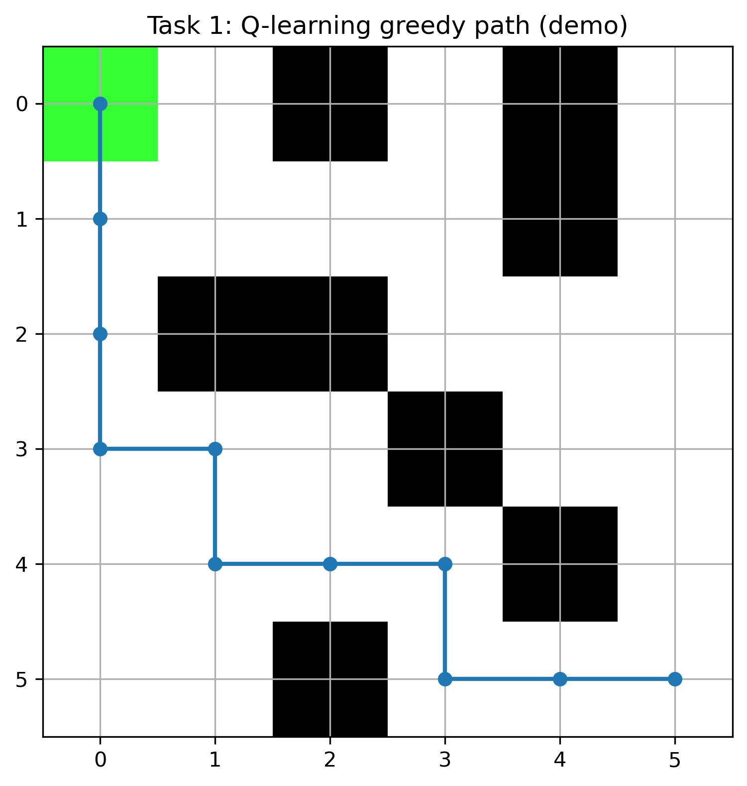
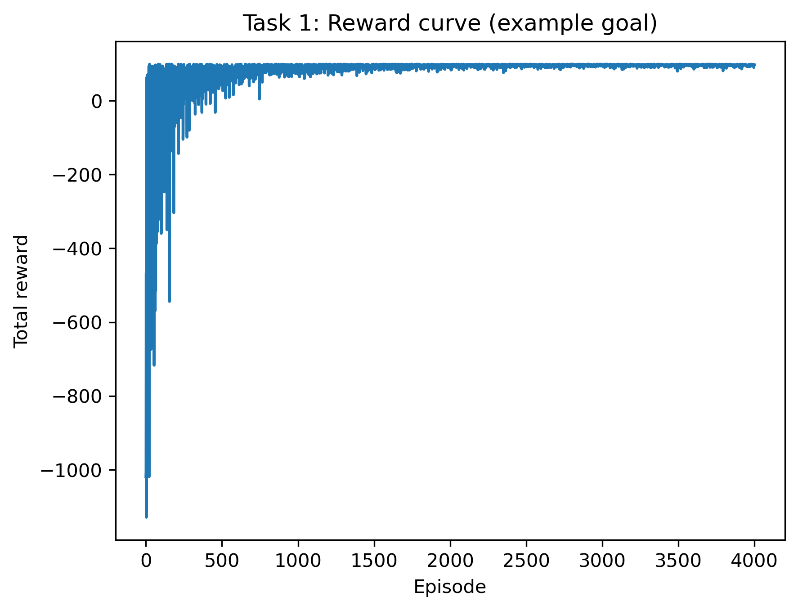
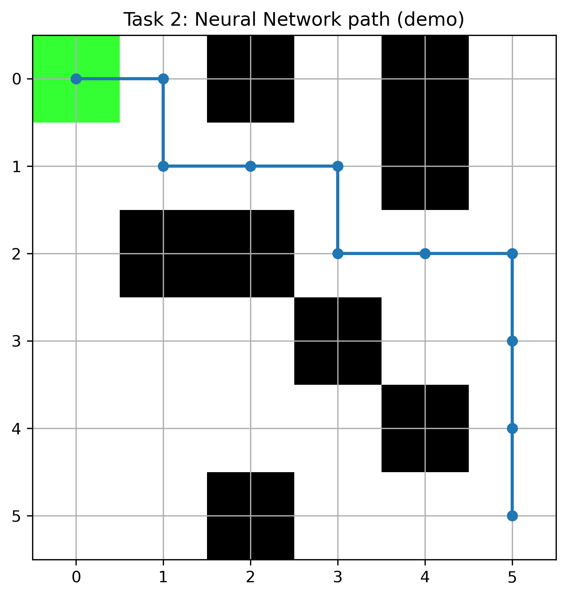

# MazeMind

MazeMind is a maze-navigation project exploring **Q-learning** and a **neural network**. It trains a Q-learning agent on a grid maze, uses the resulting state/action examples to train a neural-network controller, and tests maze-solving on two additional maze configurations.

## Results from the saved run

- Random seed: **67**
- Free cells in the main maze: **28**
- Generated dataset: **756 rows**
- Neural-network training accuracy: **100%**
- Neural-network test accuracy: **88.9%**
- Neural-network test RMSE on action labels: **0.638**
- Both Task 1 and Task 2 demonstration paths reached their goals in **10 steps**.
- Task 3: `maze1.txt` reached its goal in **9 steps**, and `maze2.txt` in **10 steps**.

These are results from the included example run. The neural network predicts actions learned from Q-learning rather than learning directly from raw images.

## Example visualizations

### Q-learning path


### Reward during training


### Neural-network path


## Run locally

1. Install Python and Jupyter Notebook or JupyterLab.
2. Install dependencies:

   ```bash
   pip install -r requirements.txt
   ```

3. Open `main.ipynb` and run its cells in order from the repository root.
4. Keep `maze1.txt` and `maze2.txt` alongside `main.ipynb`. The notebook creates/updates `results_task1_task2/` and `results_task3/` when run.

## Layout

```text
MazeMind/
├── README.md
├── requirements.txt
├── main.ipynb
├── maze1.txt
├── maze2.txt
├── results_task1_task2/
│   ├── qlearning_dataset_756.csv
│   ├── summary_results.txt
│   ├── task1_qlearning_path.png
│   ├── task1_reward_curve_example.png
│   └── task2_nn_path.png
└── results_task3/
    ├── task3_summary.txt
    ├── maze1_path.png
    ├── maze1_reward_curve.png
    ├── maze2_path.png
    └── maze2_reward_curve.png
```
